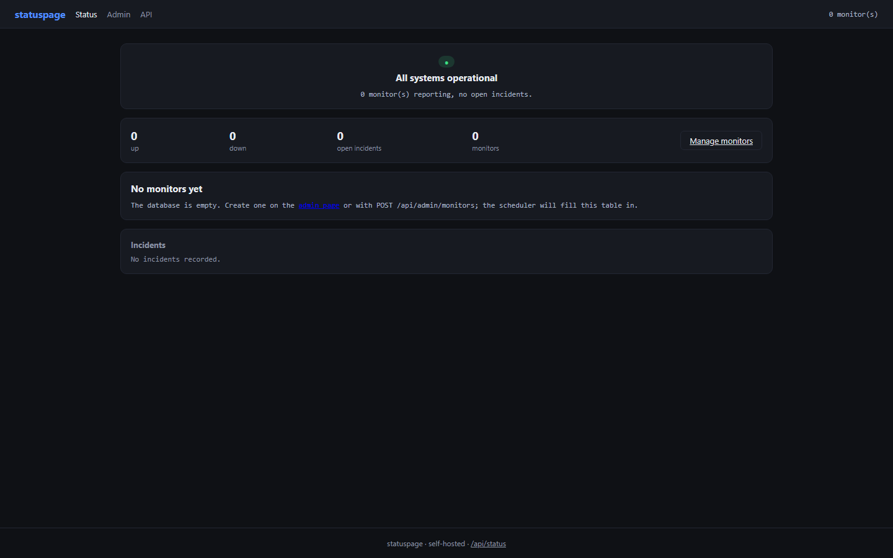
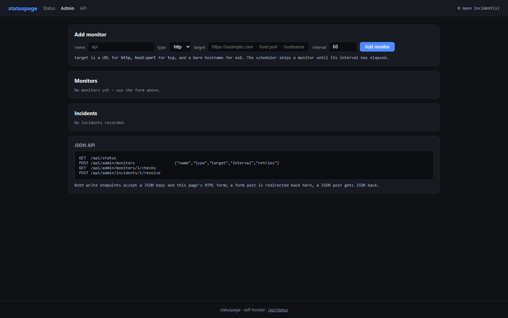
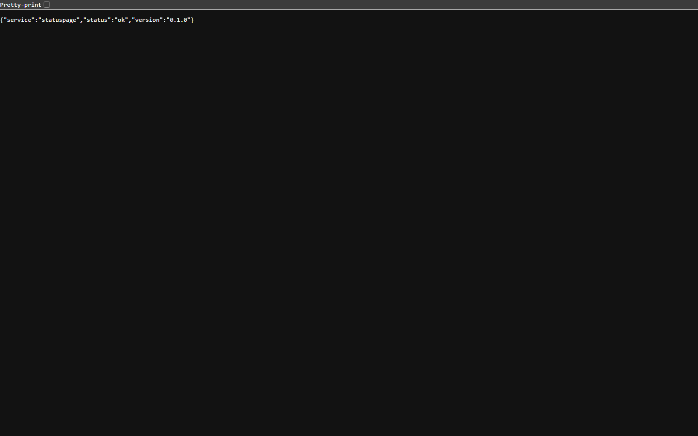
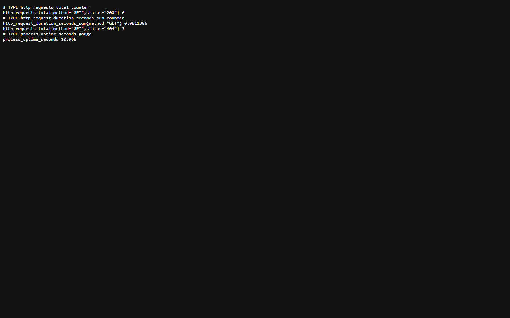
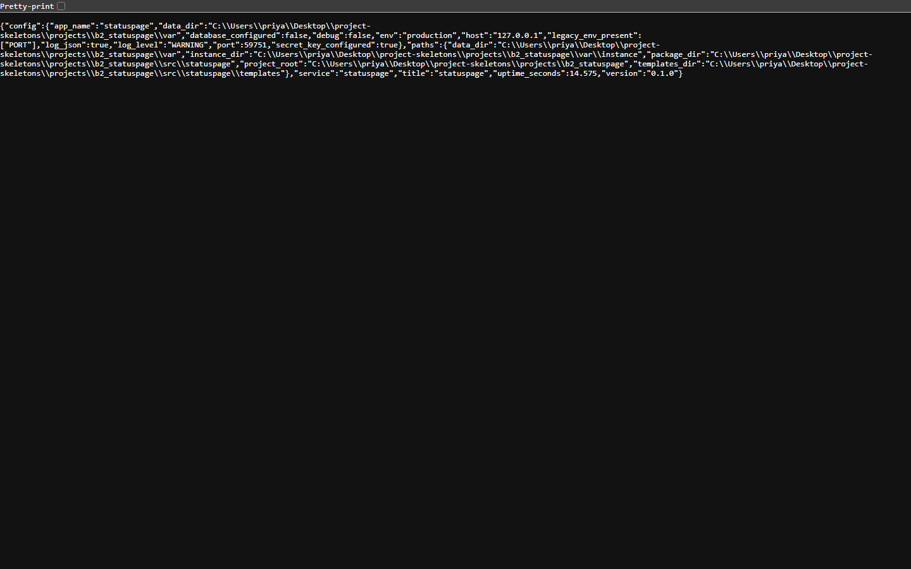

<p align="center">
  
</p>

<h1 align="center">uptimescope</h1>

<p align="center"><b>Uptime monitoring with a public status page that tells the truth.</b></p>

<p align="center">
  <a href="#quality-gates"></a> <a href="#quality-gates"></a> <a href="#api"></a> <a href="#requirements"></a> <a href="LICENSE"></a>
</p>

uptimescope probes the endpoints you list on an interval, stores every check, opens an incident when a probe starts failing, and serves a public page with the uptime percentage and the incident history.

---

**Contents** &nbsp;·&nbsp; [Why](#why-this-exists) &nbsp;·&nbsp; [What it does](#what-it-does) &nbsp;·&nbsp; [Quickstart](#quickstart) &nbsp;·&nbsp; [API](#api) &nbsp;·&nbsp; [Screenshots](#screenshots) &nbsp;·&nbsp; [Measured](#measured-not-estimated) &nbsp;·&nbsp; [Architecture](#architecture) &nbsp;·&nbsp; [Quality gates](#quality-gates) &nbsp;·&nbsp; [Deploy](#deploy) &nbsp;·&nbsp; [Limits](#limits-stated-rather-than-hidden)

## Why this exists

A status page is only worth reading if it is generated from the same checks that trigger alerts. This one stores each probe result, computes uptime from those rows, and shows the last 30 checks per monitor as a strip — no hand-edited banner.

## What it does

| Capability | How it works |
| --- | --- |
| **Background scheduler** | A poller thread runs the probes on an interval; disabling it is one environment variable. |
| **Check history** | Every probe result is a row with status, latency and timestamp. |
| **Incidents** | An incident opens after the monitor's retry budget of consecutive failures and closes on the first success; resolving one is an explicit action with a timestamp. |
| **Public page and JSON** | The same data renders as HTML for humans and GET /api/status for machines. |
| **Admin page** | Add monitors and resolve incidents without touching the API. |

## Quickstart

```sh
git clone https://github.com/scar8969/uptimescope.git
cd uptimescope
python -m venv .venv && . .venv/bin/activate   # Windows: .venv\Scripts\activate
pip install -e ".[dev]"
python wsgi.py                                 # http://127.0.0.1:8000
```

The same work from the CLI:

```sh
python -m statuspage.cli --help
```

Commands: `status`, `add`, `checks`, `resolve`, `monitors`.

A first request:

```sh
curl -s http://127.0.0.1:8000/ | head
```

## Requirements

- Python **3.11+** — CI runs 3.11, 3.12 and 3.13.
- Runtime dependencies: `Flask>=3.0`, `Flask-SQLAlchemy>=3.1`, `SQLAlchemy>=2.0`, `PyYAML>=6.0`.
- No JavaScript build step: every page is server-rendered Jinja.

## API

Every route below is in [`openapi/uptimescope.yaml`](openapi/uptimescope.yaml) and is exercised by the live probe recorded in [`docs/EVIDENCE.md`](docs/EVIDENCE.md).

| Method | Path | What it does |
| --- | --- | --- |
| `GET` | `/` | public status page (HTML) |
| `GET` | `/admin` | admin page (HTML) - add monitors, resolve incidents |
| `GET` | `/api/status` | public status as JSON |
| `POST` | `/api/admin/monitors` | add monitor |
| `GET` | `/api/admin/monitors/<int:mid>/checks` | last 100 checks for a monitor |
| `POST` | `/api/admin/incidents/<int:iid>/resolve` | resolve an incident |

## Screenshots

Captured from the running service with headless Chromium at 1440×900, one image per page, committed under [`docs/assets/screens/`](docs/assets/screens/).

<table>
<tr>
<td width="50%"><br><sub><code>/admin</code> &middot; 38.4 KB</sub></td>
<td width="50%"><br><sub><code>/healthz</code> &middot; 8.3 KB</sub></td>
</tr>
</table>

<table>
<tr>
<td width="50%"><br><sub><code>/livez</code> &middot; 7.3 KB</sub></td>
<td width="50%"><br><sub><code>/metrics</code> &middot; 14.8 KB</sub></td>
</tr>
</table>

<table>
<tr>
<td width="50%"><br><sub><code>/readyz</code> &middot; 7.7 KB</sub></td>
<td width="50%"><br><sub><code>/version</code> &middot; 26.0 KB</sub></td>
</tr>
</table>

## Measured, not estimated

These numbers were produced on this checkout by `pytest --cov` and by booting `wsgi.py` and issuing one real GET per documented path. The commands are in [`docs/EVIDENCE.md`](docs/EVIDENCE.md).

| Signal | Value |
| --- | --- |
| Tests | **25 / 25 passed** (3.8 s, exit 0) |
| Line coverage | **60.0%** — 486 of 761 statements |
| Source | 16 files / 1,643 lines |
| Test code | 4 files / 264 lines |
| Documented paths | 6 in the spec, 4 GET |
| Live probe | 9 GET requests to the booted app, **8 answered 200** |
| Median latency | **7.8 ms** (single uncached request, dev server) |
| Slowest / fastest | 47.5 ms `/` / 4.9 ms `/metrics` |
| Bytes served | 11.9 KB across 9 responses |
| Screenshots | 7 captured |

## Architecture

```
uptimescope/
├── src/statuspage/
│   ├── http.py                         379  HTTP plumbing for statuspage: correlation ids, acces
│   ├── config.py                       174  Environment-driven configuration for statuspage
│   ├── observability.py                169  Structured logging and request correlation for statu
│   ├── cli.py                          165  statuspage command line client
│   ├── _app.py                         133  Flask application: the public status page plus the J
│   ├── app.py                          119  Application factory for statuspage
│   ├── monitor/api.py                  110  JSON API for the status page and the admin UI
│   ├── errors.py                       108  Typed application errors and their HTTP mapping for 
│   ├── monitor/scheduler.py             92  Polling scheduler: every `interval` seconds, check e
│   ├── paths.py                         52  Filesystem layout for statuspage
│   ├── monitor/incidents.py             47  Incident detection and uptime maths
│   ├── models.py                        38  
├── openapi/uptimescope.yaml               the contract of record
├── schema/uptimescope.sql                 the DDL
├── tests/                       the suite that has to stay green
├── docs/EVIDENCE.md             the recorded live route walk
├── Dockerfile                   multi-stage build
└── wsgi.py                      entry point
```

The package keeps one shape across the service: `config.py` reads the environment once, `observability.py` emits structured JSON logs carrying a request id, `errors.py` turns exceptions into a single JSON envelope, `models.py` holds the tables, and the `monitor/` package holds the routes.

## Quality gates

| Gate | Command | Threshold |
| --- | --- | --- |
| Suite | `pytest -q` | all green |
| Coverage | `pytest --cov` | floor set in `pyproject.toml` from the measured value |
| Lint | `ruff check src tests` | zero findings |
| Format | `ruff format --check src tests` | zero reformats |
| Types | `mypy src` | zero errors |
| Security | `bandit -c pyproject.toml -r src` | reviewed skip list, no unreviewed finding |
| Live routes | boot `wsgi.py`, one GET per documented path | no 5xx, no undocumented guard |

CI runs the first six on Python 3.11, 3.12 and 3.13 for every push to `main`, plus a container build. See [`.github/workflows/ci.yml`](.github/workflows/ci.yml).

## Deploy

```sh
docker build -t uptimescope .
docker run --rm -p 8000:8000 --env-file .env.example uptimescope
```

Configuration is environment-only — every variable is documented in [`.env.example`](.env.example), and the service refuses to start with a production secret missing.

## Limits, stated rather than hidden

- Probes run from the host the service runs on, so they measure that vantage point only.
- Uptime is computed from stored checks, so a window with no checks reports 100% rather than unknown.

## License

MIT — see [LICENSE](LICENSE).
